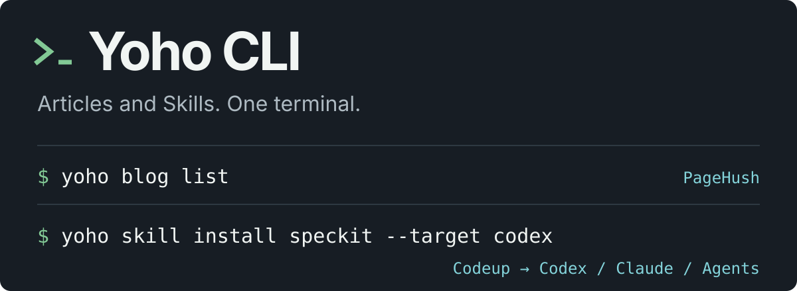

<p align="center">
  <picture>
    <source media="(max-width: 600px)" srcset="docs/assets/readme-hero-mobile.svg">
    
  </picture>
</p>

# Yoho CLI

**Manage remote articles and Agent Skills from one terminal.**

**English** · [简体中文](README.zh-CN.md)

[](https://nodejs.org/) [](https://pnpm.io/) [](https://www.typescriptlang.org/)

[Quick start](#quick-start) · [Terminal interface](#terminal-interface) · [Articles](#manage-remote-articles) · [Skills](#install-update-and-remove-skills) · [Diagnostics](#environment-diagnostics) · [JSON API](#json-results-and-exit-codes)

Yoho is a local TypeScript CLI. Use its interactive menu for everyday work, or explicit commands and `--json` for scripts and local products.

```bash
# Open the interactive menu
yoho

# Read PageHush articles; run yoho auth login before first use
yoho blog list

# Install a Codeup Skill into the current project
yoho skill install speckit --target codex
```

| Your task                                 | What Yoho provides                                                                                |
| ----------------------------------------- | ------------------------------------------------------------------------------------------------- |
| Manage PageHush articles                  | Upload Markdown and inline images, inspect articles, publish and soft-delete with revision checks |
| Manage Codeup Skills                      | Discover sources, install into Codex, Claude or Agents, update and uninstall offline              |
| Integrate with scripts and local products | One JSON result on stdout for success or failure, with distinct exit codes                        |

PageHush is the authoritative article store; local Markdown is an upload input. Skill updates follow the registered source and recover failures per target.

## Quick start

### Install and upgrade

Requires **Node.js 24+**. Skill commands also need Git, OpenSSH and authorized Codeup SSH access. Users do not need pnpm or a source checkout. Full installation acceptance currently targets macOS.

```bash
npm install --global @yohoia/cli@latest
yoho --version
yoho doctor
yoho
```

Run the same install command to upgrade. These npm commands become available after the first npm release; until then, use the source build below.

```bash
# Run temporarily without a global install
npx --package=@yohoia/cli@latest yoho

# Pin a version
npm install --global @yohoia/cli@0.8.0

# Remove the CLI while keeping configuration and installed Skills
npm uninstall --global @yohoia/cli
```

**Migrating from the old package:** run `npm uninstall --global yoho-cli` before installing `@yohoia/cli`, because both provide the `yoho` command. Configuration, system credentials and Skill directories stay in place.

If the global prefix is not writable, use `--prefix "$HOME/.local"` and add `$HOME/.local/bin` to `PATH`. See the [distribution and release guide](docs/distribution.md) for custom prefixes, Release tarballs, migration and maintainer setup.

<details>
<summary>Build an installation package from source (developers, pnpm 11.25.0)</summary>

```bash
pnpm install --frozen-lockfile
pnpm check
pnpm release:pack
npm install --global ./artifacts/release/yohoia-cli-0.8.0.tgz
yoho doctor
```

</details>

### First successful run

Skill management needs Codeup SSH access, without a PageHush login:

```bash
yoho skill list
```

To install a Skill without opening the interactive menu, provide its name and at least one target:

```bash
yoho skill install speckit --target codex
```

For article commands, configure or accept the default PageHush service, authorize the device, then list articles:

```bash
yoho auth login
yoho blog list
```

## Terminal interface

Run `yoho` to choose **Blog · Skill · Auth · Settings**. Run `yoho blog` or `yoho skill` to open a list directly.


| Action                                        | Keys                          |
| --------------------------------------------- | ----------------------------- |
| Move / open / back                            | Arrows or J/K · Enter · Q/Esc |
| Select / select all / invert                  | Space · A · Tab               |
| Search / page / refresh                       | `/` · H/L · R                 |
| Sort field / direction                        | S · O                         |
| Upload / publish / delete articles            | N · P · D                     |
| Install / update / uninstall Skills / sources | I · U · D · M                 |

Publishing, deletion, and overwrite updates preview their targets and default to cancel. Ctrl+C waits for cleanup and restores the terminal. During search, Enter applies, Ctrl+U clears, and Esc clears the search. Command-mode pickers use `a` to select all and `i` to invert.

Set `NO_COLOR=1` to disable colors. Redirected output has no progress animation. Without a terminal, or with `TERM=dumb`, the bare entry point prints help.

## Environment diagnostics

```bash
yoho doctor
yoho doctor --json
```

Checks Node.js, Git, OpenSSH, Codeup SSH selection and PageHush service URL configuration. The checks are read-only: no remote requests, private-key or token contents, or configuration writes. A passing report exits with 0. Missing tools, an unreadable explicitly selected key or invalid service configuration exit with 2 and retain all check results. Unverified permissions produce warnings; use `yoho skill list` to verify actual Codeup access.

## Configure the PageHush service

The built-in service is `https://pagehush.yohoia.cn`. Save a default service or override it for one command:

```bash
yoho config server https://your-pagehush.example
yoho --server https://your-pagehush.example blog list
```

The service-resolution order is `--server`, `YOHO_SERVER`, the saved default, then the built-in default. Service URLs must be HTTPS origins without credentials, paths, queries, or fragments; HTTP is accepted only for localhost test fixtures.

| Variable          | Purpose                                                                                   |
| ----------------- | ----------------------------------------------------------------------------------------- |
| `YOHO_SERVER`     | Overrides the default PageHush service.                                                   |
| `YOHO_TOKEN`      | Supplies an existing device token for scripts without writing it to the credential store. |
| `YOHO_CONFIG_DIR` | Isolates configuration, Skill state, and the minimum operation records.                   |
| `XDG_CONFIG_HOME` | Provides the parent directory for `~/.config/yoho` when `YOHO_CONFIG_DIR` is unset.       |

Configuration and operation records do not contain article bodies, image bytes, or stored credentials. Service credentials are kept separate for each service origin. Server-side operation results are retained for at least seven days; after that, an unresolved result may need manual verification.

## Authorize a device

```bash
yoho auth login
yoho auth status
yoho auth logout
```

`login` prints a device code and approval URL, then waits for approval in PageHush. Use `--no-browser` on a remote terminal. Authorization lasts 30 days and is not automatically refreshed. On macOS, tokens use the Keychain; Linux uses an available Secret Service. If the credential store is unavailable, the CLI fails instead of writing a plaintext token.

## Manage remote articles

### List and inspect

```bash
yoho blog list
yoho blog list --status draft --keyword 'command line' --page 1 --page-size 20
yoho blog list --status published --page 2 --json
yoho blog show 'ARTICLE_UUID'
yoho blog show 'COMPLETE_SHORT_ID' --json
```

`list` returns non-deleted drafts and published articles, 20 per page by default. Filters run before pagination. Results are ordered by the server's recorded update time and include the next-page cursor when one exists. Terminal output is a width-aware table; JSON retains the complete structured result.

Article identity is a UUID or complete short ID. Titles, slugs, short-ID prefixes, and local paths are not remote identities. `show` returns the complete Markdown body, server metadata, and an opaque `revision` value that must be passed back for guarded writes.

### Upload a Markdown draft

```bash
yoho blog create ./article.md
yoho blog create '/absolute/path/article.md' --json
```

`create` accepts one readable UTF-8 `.md` file. It does not accept directories, MDX, stdin, or a separate body argument. The source document and local images remain unchanged. A draft title comes from non-empty frontmatter `title`, the first level-one heading outside code blocks, or the file name. Supported frontmatter imports are `title`, `description`, and `language` (`zh` or `en`, default `zh`). Invalid fields, empty content, or a document containing only frontmatter fail before a remote write.

Local Markdown images are preflighted and uploaded through the PageHush asset API. JPEG, PNG, and WebP are supported up to 5 MiB per image. Remote images, existing PageHush asset URLs, and anchors stay unchanged. HTML images, reference-style image definitions, MDX components, unresolved local resources, and recursive attachment uploads are outside this flow. The CLI never connects directly to MinIO.

Each `create` starts a new article and returns a request ID. If a write times out or is interrupted, query or resume that request instead of running `create` again:

```bash
yoho blog operation 'REQUEST_UUID' --json
yoho blog resume 'REQUEST_UUID' ./article.md --json
```

### Publish with a revision precondition

```bash
yoho blog show 'ARTICLE_UUID' --json
yoho blog publish 'ARTICLE_UUID' --if-match 'REVISION_FROM_SHOW' --json
```

`publish` requires the revision returned by `show`. The server checks the revision atomically, so a stale value does not publish or overwrite newer web edits. Publishing an already-published article with the same revision returns `changed=false` without changing its timestamps.

### Preview and soft-delete

```bash
yoho blog delete 'ARTICLE_UUID' --dry-run --json
yoho blog delete 'ARTICLE_UUID' --yes --if-match 'REVISION_FROM_PREVIEW' --json
```

`--dry-run` only reads the target. Actual deletion requires both `--yes` and `--if-match`; the server performs an atomic revision check and marks the article as soft-deleted. The record and assets remain available to the service, but the article leaves normal lists, details, and blog reads. Permanent deletion and recovery are not CLI operations.

## Install, update, and remove Skills

Skill commands use the current user's registered Codeup sources and do not require PageHush authorization. A new configuration starts with these sources:

- `69aa892db28d0aba0f5ed47e/yoho-standard-readme`
- `69aa892db28d0aba0f5ed47e/yoho-retro-poster`
- `69aa892db28d0aba0f5ed47e/yoho-speckit` (the Skill name is `speckit`)

Manage sources with:

```bash
yoho skill source list
yoho skill source add namespace/repo
yoho skill source add https://codeup.aliyun.com/namespace/repo
yoho skill source refresh
yoho skill source remove namespace/repo
```

Sources are saved for the current user and shared across projects. An unavailable source keeps its last catalog entry and reports the reason, but installation and updates require the current commit. Reads use Git + SSH and never contact GitHub or call `gh`. Install Git and OpenSSH and register an authorized SSH public key in Codeup. The CLI automatically uses `~/.ssh/github_codeup_sync_ed25519` when present, otherwise your SSH configuration/agent; set `YOHO_SKILL_SSH_KEY` to use another private key. Standard `GIT_SSH_COMMAND` configuration is also supported. Private key contents are not stored in CLI state or caches. Existing registrations and installation records for the three original Yohoia sources migrate automatically to their Codeup mirrors; unrecognized old GitHub sources remain unavailable until explicitly replaced. Removing a source pauses updates without uninstalling its Skills; adding it again resumes management.

### Installation targets

Installation defaults to the current project. Use `--project-path` to select another project or `--scope user` for the current user's target directories.

| Target   | Project scope    | User scope         |
| -------- | ---------------- | ------------------ |
| `claude` | `.claude/skills` | `~/.claude/skills` |
| `agents` | `.agents/skills` | `~/.agents/skills` |
| `codex`  | `.codex/skills`  | `~/.codex/skills`  |

Installation can prompt for names and targets. Updates prompt only for Skills:

```bash
yoho skill install
yoho skill update
```

<details>
<summary>List states and version labels</summary>

The picker uses a compact list with details for the focused item. Use arrow keys to move, Space to toggle, `a` to select or clear all enabled items, `i` to invert, Enter to confirm, and Ctrl+C to cancel. Long lists scroll, and completed steps collapse to a summary.

`yoho skill list` uses English column headings and displays green `installed` or light-gray `not installed` states. Lists omit section titles and show a footer such as `Total: 3 · 1 installed · 2 not installed`. Versions come from YAML metadata in the root `SKILL.md`, including `metadata.version`:

```yaml
metadata:
  version: "0.1.1"
```

Top-level `version: "0.1.1"` is also supported and takes precedence when both fields exist. The terminal displays `v0.1.1`, or 未标注 when no version is declared. Installed rows show local versions; other rows show repository versions. Use `--target` to include installation paths.

</details>

The CLI manages only Skills linked to registered sources or existing installation records. Manually copied Skills match registered names from root `SKILL.md` files. Unrelated third-party Skills without a match or record do not appear in the update menu, update-all results, or installation records. Previously managed installations retain recovery guidance when their source is removed.

`yoho skill update` compares the latest source commit and actual files, then lists only Skills with changes. When everything matches, it displays 无可用更新，Skill 均为最新版. Local edits also count as changes. Selecting a Skill immediately updates all its recorded installation paths, including other projects, without asking for a scope or tool. Unrecorded manual installations are discovered only in the three standard directories under the current project and user home, and associated by a unique root `SKILL.md` name.

Removed, unavailable, ambiguous, and renamed sources produce separate diagnostics and stay outside the choices. Failed checks are never reported as current. Update result tables contain only Skill, status, and version. Status is 已更新 for success or 更新失败 for failure; the version is the latest declaration fetched for the operation. Network, permission, and write failures return a nonzero exit code.

For automation, provide every selection explicitly:

```bash
yoho skill install speckit yoho-retro-poster --target claude --target agents
yoho skill install speckit --scope user --target codex
yoho skill install speckit --project-path /path/to/project --target agents
yoho skill list --target claude --target agents --json
yoho skill update speckit
yoho skill update --all --json
yoho skill update speckit --target agents
yoho skill update speckit yoho-retro-poster --target claude --json
yoho skill update --all --scope user --target agents --target codex --json
```

Explicit `--scope`, `--target`, or `--project-path` options narrow an update to those locations. Without these options, updates use existing installation paths. They do not scan other projects for unrecorded installations or fill missing targets. Version labels are for display; updates still use the latest default-branch commit rather than sorting versions or selecting historical releases.

Installation protects existing target directories and fills only missing targets. Each operation fixes the latest Codeup default-branch commit once per source, caches Git objects and fetches files on demand, copies the complete Skill tree without Git metadata, and never runs Skill scripts or installs npm/pip dependencies. Updates treat the repository as authoritative: local edits are overwritten, deleted repository files are restored, and local files absent from the repository are removed. Update failures recover the affected target and continue with other targets; initial batch-install failures roll back the new batch while preserving existing installations.

### Uninstall a Skill while keeping its source

```bash
# List installed Skills, select one or several, then confirm removal
yoho skill uninstall

# Remove all recorded locations and installation records; keep the source
yoho skill uninstall speckit

# Preview directories and installation records without deleting them
yoho skill uninstall speckit --dry-run

# Explicit confirmation for scripts; accepts names or namespace/repo
yoho skill uninstall speckit yoho-retro-poster --yes

# Remove all managed installations while keeping the catalog
yoho skill uninstall --all --yes
```

Run `yoho skill uninstall` without names to choose from installed, managed Skills. Use arrows to move, Space to select one or several, and Enter to continue. Use `a` to select or clear all, `i` to invert, and Ctrl+C to cancel. The picker groups installation locations by Skill and shows their count; confirmation lists the actual directories. Uninstalled and unrelated third-party Skills are excluded. If nothing is installed, the command reports that and exits.

`yoho skill remove` aliases `uninstall`. Uninstall deletes only local files and installation records. It always keeps source registrations: `yoho skill list` still shows the Skill as `not installed`, and you can reinstall it directly. Only `yoho skill source remove namespace/repo` removes a source registration; that command keeps installed files.

Uninstall works offline. It includes managed installations in the current project and user directories, plus recorded locations in other projects, without asking for an installation scope. Unrelated third-party Skills are excluded. Manual copies require a unique match between SKILL.md and a locally cached source name. The CLI does not scan unrecorded projects.

Noninteractive calls require `--yes` or `--dry-run`. Providing both still only previews. Interactive confirmation defaults to cancel. If one location fails, completed deletions remain complete, and the failed location's record remains available for retry. Source registrations always remain unchanged. Interrupted backups are reported and preserved. If files were deleted but saving their records failed, retry the command to clear the remaining records.

## JSON results and exit codes

Add `--json` to a business command to receive exactly one result on stdout for both success and failure. Progress, approval URLs, and import notices go to stderr. This keeps the result stream safe for local products and shell scripts.

```json
{ "ok": true, "data": { "items": [], "nextPage": null } }
```

```json
{
  "ok": false,
  "error": {
    "code": "REVISION_CONFLICT",
    "message": "文章版本已变化"
  }
}
```

| Exit code | Meaning                                                                       |
| --------: | ----------------------------------------------------------------------------- |
|       `0` | Success                                                                       |
|       `2` | Invalid arguments or configuration                                            |
|       `3` | Article or Skill data error, revision conflict, or identity conflict          |
|       `4` | Authentication, device authorization, or permission error                     |
|       `5` | Local file, network, remote I/O, or unknown-result error                      |
|     `130` | User cancellation; an issued remote write still needs request-ID verification |

## Migration and limits

The old local-article mode is removed. `--project`, path-based article IDs, `blog update`, MDX creation, and local metadata editing are rejected with a migration message. Keep local source documents and use `yoho blog create <path-to-md>` to upload a new draft; edit existing remote article content and metadata in PageHush.

The CLI does not provide editing of an existing article body, title, or metadata, article withdrawal, article archive or restore, permanent deletion, or global project binding. Skill version rollback and scheduled updates are also unavailable. The CLI and PageHush API/web version must remain compatible.

## Development and validation

```bash
pnpm install --frozen-lockfile
pnpm check
pnpm format:check
pnpm test:prepare
pnpm test
```

The suite builds and exercises the installed CLI in child processes. Remote tests use isolated databases, credentials, and storage. `tests/helpers/pagehush-backend.json` pins the backend Git revision, lockfile digest, fixture entry, and required build outputs.

An existing local repository can supply the pinned Git objects. Preparation creates a separate checkout in `.cache/test-backends/`, without using or modifying uncommitted files:

```bash
pnpm test:prepare --source /path/to/PageHush
# Use offline mode when the npm cache is complete
pnpm test:prepare --source /path/to/PageHush --offline
```

Preparation installs locked dependencies with `npm ci` and builds the shared package. It can be rerun. Test startup checks the revision, clean worktree, lockfile, and required artifacts. `PAGEHUSH_SOURCE` can point to another prepared checkout, but it must match the pinned revision and pass those checks.

Skill tests use real local Git repositories, an isolated SSH transport boundary, controlled source faults, temporary directories, Python 3, and the system `tar` command. They do not read real SSH credentials or modify real Skill directories.

Project documentation: [current specs and architecture decisions](docs/README.md) · [repository structure](docs/structure.md) · [domain glossary](GLOSSARY.md).

## License

Licensed under the [MIT License](LICENSE).
