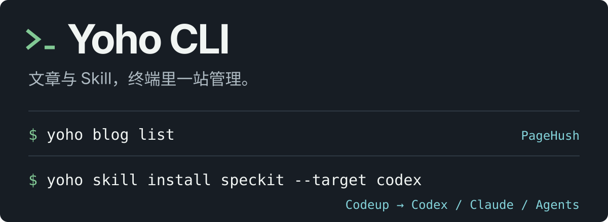
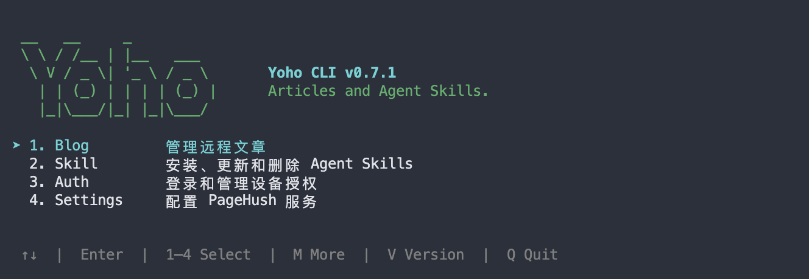

<p align="center">
  <picture>
    <source media="(max-width: 600px)" srcset="docs/assets/readme-hero-zh-mobile.svg">
    
  </picture>
</p>

# Yoho CLI

**在一个终端里，管理远程文章和 Agent Skill。**

[English](README.md) · **简体中文**

[](https://nodejs.org/) [](https://pnpm.io/) [](https://www.typescriptlang.org/)

[快速开始](#快速开始) · [终端界面](#终端界面) · [远程文章](#管理远程文章) · [Skill 管理](#安装更新和删除-skill) · [环境诊断](#环境诊断) · [JSON 接口](#json-结果和退出码)

Yoho 是使用 TypeScript 编写的本地 CLI。用交互菜单完成日常操作，或用完整命令和 `--json` 接入脚本与本地产品。

```bash
# 交互入口
yoho

# 读取 PageHush 文章；首次使用需先 yoho auth login
yoho blog list

# 从 Codeup 安装 Skill 到当前项目
yoho skill install speckit --target codex
```

| 你要做的事         | Yoho 提供的能力                                          |
| ------------------ | -------------------------------------------------------- |
| 管理 PageHush 文章 | 上传 Markdown 和行内图片、查看文章、按版本发布与软删除   |
| 管理 Codeup Skill  | 发现来源，安装到 Codex、Claude 或 Agents，更新与离线卸载 |
| 接入脚本与本地产品 | 成功与失败均向 stdout 输出单个 JSON 结果，退出码区分错误 |

PageHush 是文章的权威来源；本地 Markdown 是上传输入。Skill 更新以登记的来源为准，逐目标处理失败恢复。

## 快速开始

### 安装与升级

需要 **Node.js 24+**；Skill 功能还需要 Git、OpenSSH 和 Codeup SSH 访问权限。用户无需安装 pnpm 或克隆源码。当前完整安装验收目标为 macOS。

```bash
npm install --global @yohoia/cli@latest
yoho --version
yoho doctor
yoho
```

再次执行安装命令即可升级。首次 npm 发布完成后上述命令才可用；发布前可使用下文源码构建方式。

```bash
# 临时运行，不全局安装
npx --package=@yohoia/cli@latest yoho

# 固定版本
npm install --global @yohoia/cli@0.8.0

# 卸载 CLI，保留配置和已安装 Skill
npm uninstall --global @yohoia/cli
```

**旧包迁移：** 已安装 `yoho-cli` 时，先执行 `npm uninstall --global yoho-cli`，再安装 `@yohoia/cli`，避免同名 `yoho` 命令冲突。配置、系统凭据及 Skill 目录保持不变。

没有全局目录写权限时，可以使用 `--prefix "$HOME/.local"`，并将 `$HOME/.local/bin` 加入 `PATH`。详见[分发与发布指南](docs/distribution.md)，包含用户前缀、Release 安装包、迁移和维护者发版步骤。

<details>
<summary>从源码构建安装包（开发者，pnpm 11.25.0）</summary>

```bash
pnpm install --frozen-lockfile
pnpm check
pnpm release:pack
npm install --global ./artifacts/release/yohoia-cli-0.8.0.tgz
yoho doctor
```

</details>

### 第一条可运行命令

Skill 管理只需要 Codeup SSH 访问，不需要 PageHush 登录：

```bash
yoho skill list
```

如果不想打开交互菜单，给出 Skill 名称和至少一个目标即可安装：

```bash
yoho skill install speckit --target codex
```

使用文章命令时，先配置或接受默认的 PageHush 服务，完成设备授权，再列出文章：

```bash
yoho auth login
yoho blog list
```

## 终端界面

输入 `yoho`，在 **Blog · Skill · Auth · Settings** 之间选择；`yoho blog` 和 `yoho skill` 可直接打开对应列表。



| 操作                            | 按键                         |
| ------------------------------- | ---------------------------- |
| 移动 / 打开 / 返回              | 方向键或 J/K · Enter · Q/Esc |
| 选择 / 全选 / 反选              | Space · A · Tab              |
| 搜索 / 翻页 / 刷新              | `/` · H/L · R                |
| 排序字段 / 排序方向             | S · O                        |
| 文章上传 / 发布 / 删除          | N · P · D                    |
| Skill 安装 / 更新 / 卸载 / 来源 | I · U · D · M                |

发布、删除和覆盖更新先预览目标，确认默认取消。Ctrl+C 等待操作清理后恢复终端。搜索中 Enter 应用、Ctrl+U 清空、Esc 清除搜索；命令模式的多选用 `a` 全选、`i` 反选。

设置 `NO_COLOR=1` 关闭颜色。重定向输出不播放进度动画；非终端或 `TERM=dumb` 环境下，无参数入口显示帮助。

## 环境诊断

```bash
yoho doctor
yoho doctor --json
```

检查 Node.js、Git、OpenSSH、Codeup SSH 选择和 PageHush 服务地址配置。检查只读，不连接远程服务、不读取私钥或令牌内容、不写配置。通过时退出码为 0；缺少工具、明确指定的密钥不可读或服务配置无效时返回 2，并保留全部检查结果。待在线验证的权限只产生警告；实际 Codeup 权限仍需用 `yoho skill list` 验证。

## 配置 PageHush 服务

内置服务地址为 `https://pagehush.yohoia.cn`。可以保存默认服务，也可以只为一次命令覆盖：

```bash
yoho config server https://your-pagehush.example
yoho --server https://your-pagehush.example blog list
```

服务地址解析顺序为 `--server`、`YOHO_SERVER`、已保存默认值、内置默认值。服务地址必须是不含凭据、路径、查询参数或片段的 HTTPS origin；本机测试夹具允许使用 HTTP。

| 变量              | 用途                                                          |
| ----------------- | ------------------------------------------------------------- |
| `YOHO_SERVER`     | 覆盖默认 PageHush 服务。                                      |
| `YOHO_TOKEN`      | 为脚本提供已有设备令牌，不写入凭据存储。                      |
| `YOHO_CONFIG_DIR` | 隔离配置、Skill 状态和最少的操作记录。                        |
| `XDG_CONFIG_HOME` | 未设置 `YOHO_CONFIG_DIR` 时，为 `~/.config/yoho` 提供父目录。 |

配置和操作记录不保存文章正文、图片字节或已存储凭据。不同服务 origin 的凭据相互隔离。服务端至少保留七天操作结果；超过保留期仍无法确认的结果可能需要人工核对。

## 授权 CLI 设备

```bash
yoho auth login
yoho auth status
yoho auth logout
```

`login` 显示设备码和批准网址，然后等待用户在 PageHush 中批准。远程终端可以使用 `--no-browser`。授权有效期为 30 天，不会自动刷新。macOS 使用钥匙串保存令牌；Linux 使用可用的 Secret Service。凭据存储不可用时，CLI 会失败，不会降级为明文令牌文件。

## 管理远程文章

### 列出和查看

```bash
yoho blog list
yoho blog list --status draft --keyword 'command line' --page 1 --page-size 20
yoho blog list --status published --page 2 --json
yoho blog show 'ARTICLE_UUID'
yoho blog show 'COMPLETE_SHORT_ID' --json
```

`list` 默认返回未删除的草稿和已发布文章，每页 20 篇。筛选在分页前执行；结果按服务器记录的更新时间排序，并在有下一页时返回下一页游标。终端输出为适配宽度的表格，JSON 保留完整结构化结果。

文章身份只能使用 UUID 或完整短 ID。标题、slug、短 ID 前缀和本地路径都不是远程文章标识。`show` 返回完整 Markdown 正文、服务器元数据以及不透明的 `revision`，受保护的写入必须原样传回这个版本。

### 上传 Markdown 草稿

```bash
yoho blog create ./article.md
yoho blog create '/absolute/path/article.md' --json
```

`create` 接受一个可读的 UTF-8 `.md` 文件。不接受目录、MDX、标准输入或独立正文参数。源文档和本地图片保持不变。草稿标题依次取自非空 frontmatter `title`、代码块外第一个一级标题或文件名。支持导入的 frontmatter 字段为 `title`、`description` 和 `language`（`zh` 或 `en`，默认 `zh`）。字段非法、正文为空或文件只有 frontmatter 时，会在远程写入前失败。

本地 Markdown 图片会先预检，再通过 PageHush 素材 API 上传。支持 JPEG、PNG 和 WebP，单张上限为 5 MiB。远程图片、已有 PageHush 素材地址和锚点保持不变。HTML 图片、引用式图片定义、MDX 组件、无法解析的本地资源以及递归上传附件不在本流程内。CLI 不直接连接 MinIO。

每次 `create` 都会新建文章，并返回请求编号。如果写入超时或被中断，应查询或恢复同一个请求，不要再次运行 `create`：

```bash
yoho blog operation 'REQUEST_UUID' --json
yoho blog resume 'REQUEST_UUID' ./article.md --json
```

### 按文章版本发布

```bash
yoho blog show 'ARTICLE_UUID' --json
yoho blog publish 'ARTICLE_UUID' --if-match 'REVISION_FROM_SHOW' --json
```

`publish` 必须提供 `show` 返回的版本。服务器会原子检查版本；版本过期时不会发布，也不会覆盖网页中的新修改。对已经发布且版本匹配的文章再次发布会返回 `changed=false`，不改变时间戳。

### 预览和软删除

```bash
yoho blog delete 'ARTICLE_UUID' --dry-run --json
yoho blog delete 'ARTICLE_UUID' --yes --if-match 'REVISION_FROM_PREVIEW' --json
```

`--dry-run` 只读取目标。实际删除必须同时提供 `--yes` 和 `--if-match`；服务器原子检查版本后设置软删除标记。文章记录和素材仍由服务保留，但文章会从普通列表、详情和博客读取中隐藏。CLI 不提供永久删除和恢复操作。

## 安装、更新和删除 Skill

Skill 命令使用当前用户登记的 Codeup 来源，不需要 PageHush 授权。新配置默认包含以下来源：

- `69aa892db28d0aba0f5ed47e/yoho-standard-readme`
- `69aa892db28d0aba0f5ed47e/yoho-retro-poster`
- `69aa892db28d0aba0f5ed47e/yoho-speckit`（Skill 名称为 `speckit`）

使用以下命令管理来源：

```bash
yoho skill source list
yoho skill source add namespace/repo
yoho skill source add https://codeup.aliyun.com/namespace/repo
yoho skill source refresh
yoho skill source remove namespace/repo
```

来源按当前用户保存，各项目共用。来源不可用时会保留上次目录并报告原因，但安装和更新必须取得当前提交。读取统一使用 Git + SSH，不访问 GitHub、不调用 `gh`。需要安装 Git 和 OpenSSH，并在 Codeup 登记有仓库访问权限的 SSH 公钥。默认自动使用已有的 `~/.ssh/github_codeup_sync_ed25519`，否则复用 SSH 配置/agent；可用 `YOHO_SKILL_SSH_KEY` 指定其他私钥，也支持标准 `GIT_SSH_COMMAND` 配置。私钥内容不写入 CLI 状态或缓存。旧三个 Yohoia 来源及安装记录会自动迁移到对应 Codeup 镜像；未确认映射的旧 GitHub 来源保留为不可用，需手动替换。移除来源会暂停更新但不会卸载已安装的 Skill；重新添加后可以继续管理。

### 安装目标

安装默认范围为当前项目。使用 `--project-path` 指定其他项目，使用 `--scope user` 安装到当前用户的目标目录。

| 目标     | 项目级目录       | 用户级目录         |
| -------- | ---------------- | ------------------ |
| `claude` | `.claude/skills` | `~/.claude/skills` |
| `agents` | `.agents/skills` | `~/.agents/skills` |
| `codex`  | `.codex/skills`  | `~/.codex/skills`  |

安装时可以交互选择名称和目标；更新时只需选择 Skill：

```bash
yoho skill install
yoho skill update
```

<details>
<summary>列表状态与版本显示</summary>

选择界面使用紧凑列表与焦点详情：方向键移动，Space 勾选，`a` 全选或清空，`i` 反选，Enter 确认，Ctrl+C 取消。列表较长时自动滚动，完成的步骤收起为摘要。

`yoho skill list` 使用英文表头，安装状态为绿色 `installed` 或浅灰色 `not installed`。列表省略段落标题，底部显示 `Total: 3 · 1 installed · 2 not installed` 形式的数量统计。版本来自根 `SKILL.md` 的 YAML 元数据，支持 `metadata.version`：

```yaml
metadata:
  version: "0.1.1"
```

也兼容顶层的 `version: "0.1.1"`，两处同时声明时以顶层为准。终端统一显示为 `v0.1.1`；缺少版本时显示“未标注”。已安装项显示本机版本，未安装项显示仓库版本。指定 `--target` 时还会展示对应安装位置。

</details>

CLI 仅管理已登记来源及已有安装记录对应的 Skill。手动复制的 Skill 按根 `SKILL.md` 名称匹配登记来源；无匹配且无记录的第三方 Skill 不进入更新菜单、`--all` 结果或安装记录。来源被移除的历史安装仍保留恢复提示。

`yoho skill update` 比较来源最新提交及实际文件内容，只列出有更新的 Skill；全部一致时显示“无可用更新，Skill 均为最新版”。本地修改也视为需要同步。选中后直接更新该 Skill 的所有已记录安装位置，包括其他项目，不再询问范围或工具。未记录的手动安装只在当前项目和当前用户的三个标准目录中发现，并按根 `SKILL.md` 的名称唯一关联登记来源。

来源移除、不可用、同名歧义或名称变化会单独报告，不列入可选更新，也不会误报为最新版。更新结果表格仅包含 Skill、状态与版本，状态为“已更新”或“更新失败”，版本为本次获取的最新声明版本。发生网络、权限或写入失败时返回对应非零退出码。

自动化调用应完整提供选择参数：

```bash
yoho skill install speckit yoho-retro-poster --target claude --target agents
yoho skill install speckit --scope user --target codex
yoho skill install speckit --project-path /path/to/project --target agents
yoho skill list --target claude --target agents --json
yoho skill update speckit
yoho skill update --all --json
yoho skill update speckit --target agents
yoho skill update speckit yoho-retro-poster --target claude --json
yoho skill update --all --scope user --target agents --target codex --json
```

更新时显式提供 `--scope`、`--target` 或 `--project-path` 可以收窄到指定位置；不提供这些选项则自动使用已有安装位置，不扫描其他项目寻找未记录的安装，也不补装缺失目标。版本号用于展示，更新内容仍固定为默认分支最新提交，不按版本号排序或选择历史版本。

安装会保护已有目标目录，只补齐缺失目标。每次操作按来源获取默认分支最新提交，同一来源只下载一次；复制完整 Skill 树但排除 Git 元数据，也不会运行 Skill 脚本或安装 npm/pip 依赖。更新以仓库为准：覆盖本地修改、恢复仓库中被删除的文件，并删除仓库没有的本地文件。更新失败时恢复受影响的目标并继续处理其他目标；首次批量安装失败时回滚本批新增内容，同时保留原有安装。

### 卸载 Skill，保留来源

```bash
# 展示已安装 Skill 的列表，单选或多选后确认卸载
yoho skill uninstall

# 指定 Skill；删除它所有已记录位置及安装记录，保留来源
yoho skill uninstall speckit

# 只查看将删除的目录与安装记录
yoho skill uninstall speckit --dry-run

# 脚本中明确确认删除；支持多个名称或 namespace/repo
yoho skill uninstall speckit yoho-retro-poster --yes

# 卸载全部受管 Skill，保留来源列表
yoho skill uninstall --all --yes
```

`yoho skill uninstall` 不带名称时展示已安装的受管 Skill 多选列表；上下键移动、空格勾选，选一项或多项后按 Enter 继续，`a` 全选或清空、`i` 反选、Ctrl+C 取消。列表按 Skill 合并安装位置并显示数量，确认时展开实际目录；未安装项和不受管的第三方 Skill 不列入可选项。没有已安装项时直接提示并退出。

`yoho skill remove` 是 `uninstall` 的别名。卸载只删除本地文件和安装记录，始终保留来源登记；`yoho skill list` 仍展示该 Skill，状态为 `not installed`，可以直接重新安装。只有 `yoho skill source remove namespace/repo` 会移除来源登记，这不会删除已安装文件。

删除完全离线，默认处理当前项目、用户标准目录中的受管安装，以及其他项目的已记录位置，不再询问安装范围。没有来源匹配且没有记录的第三方 Skill 不进入删除范围。未记录的手动副本需要本地缓存的来源名称与 SKILL.md 名称唯一对应；CLI 不会扫描未记录的其他项目。

非交互调用必须添加 `--yes`，或使用 `--dry-run` 预览；两者同时提供仍只预览。交互确认默认取消。某个位置失败时，其他已删除位置保留结果，失败位置的记录保留以供重试，来源始终保持不变。发生中断备份时先报告恢复位置，不自动清除备份。文件已经删除但记录写入失败时会报告错误，重试可清理残留记录。

## JSON 结果和退出码

为业务命令添加 `--json` 后，成功和失败都会向 stdout 输出一个结果，每次调用只有一个 JSON 结果。进度、批准网址和导入提示写入 stderr，便于本地产品和脚本稳定读取结果。

```json
{ "ok": true, "data": { "items": [], "nextPage": null } }
```

```json
{
  "ok": false,
  "error": { "code": "REVISION_CONFLICT", "message": "文章版本已变化" }
}
```

| 退出码 | 含义                                           |
| -----: | ---------------------------------------------- |
|    `0` | 成功                                           |
|    `2` | 参数或配置错误                                 |
|    `3` | 文章或 Skill 数据错误、版本冲突或身份冲突      |
|    `4` | 认证、设备授权或权限错误                       |
|    `5` | 本地文件、网络、远程 I/O 或结果未知            |
|  `130` | 用户取消；已经发出的远程写入仍需按请求编号核对 |

## 迁移和边界

旧的本地文章模式已经移除。`--project`、路径型文章标识、`blog update`、MDX 创建和本地元数据编辑会返回迁移提示。请保留本地源文档，使用 `yoho blog create <path-to-md>` 上传新草稿；已有远程文章的正文和元数据请在 PageHush 中编辑。

CLI 不提供已有文章正文、标题或元数据的编辑，不提供文章撤回、归档或恢复、永久删除、全局项目绑定。Skill 也不支持版本回退或定时更新。CLI 与 PageHush API/网页版本需要保持兼容。

## 开发和验收

```bash
pnpm install --frozen-lockfile
pnpm check
pnpm format:check
pnpm test:prepare
pnpm test
```

测试先构建并安装 CLI，再通过子进程验收。远程测试使用隔离数据库、凭据和素材存储。后端版本由 `tests/helpers/pagehush-backend.json` 固定，包括 Git 提交、依赖锁文件摘要、测试入口及构建产物；不直接运行相邻仓库的任意工作区。

如果本机已有 PageHush Git 仓库，可以用它提供固定提交；该命令在 `.cache/test-backends/` 创建独立检出，不使用或修改其未提交文件：

```bash
pnpm test:prepare --source /path/to/PageHush
# 本机 npm 缓存完整时可离线准备
pnpm test:prepare --source /path/to/PageHush --offline
```

准备脚本使用 `npm ci` 安装锁定依赖并构建共享包，可重复运行。测试启动检查后端提交、工作树、锁文件及必要产物。`PAGEHUSH_SOURCE` 仍可指向其他已准备的干净检出，但必须匹配固定版本；不匹配会明确失败。

Skill 测试使用真实本机 Git 仓库、隔离 SSH 协议边界、可控来源故障、临时目录、Python 3 和系统 `tar` 命令。测试不会读取真实 SSH 凭据，也不会修改真实 Skill 目录。

更多项目资料：[当前规格与架构决策](docs/README.md) · [目录结构](docs/structure.md) · [领域术语](GLOSSARY.md)。

## 许可证

本项目采用 [MIT 许可证](LICENSE)。
