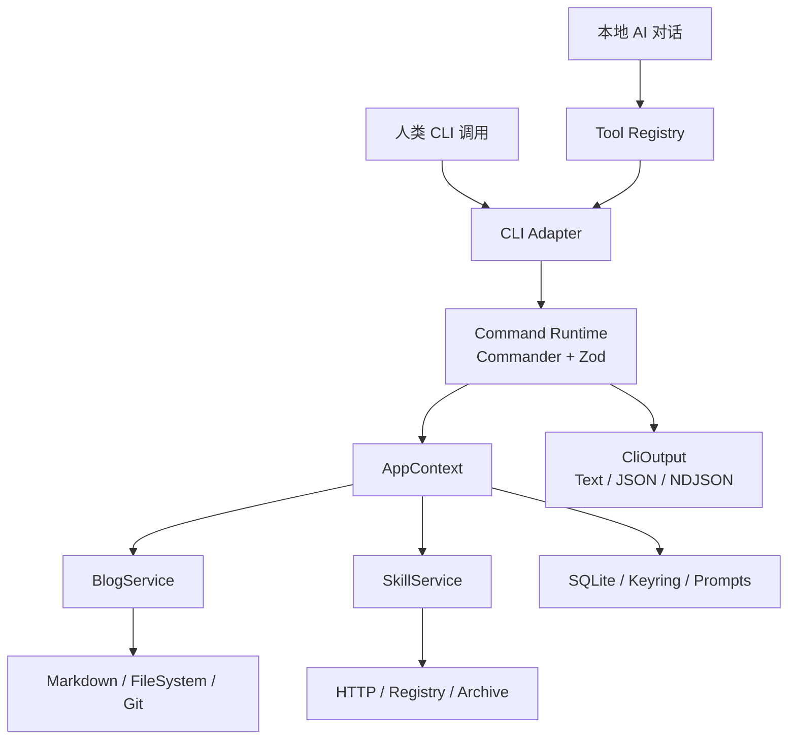
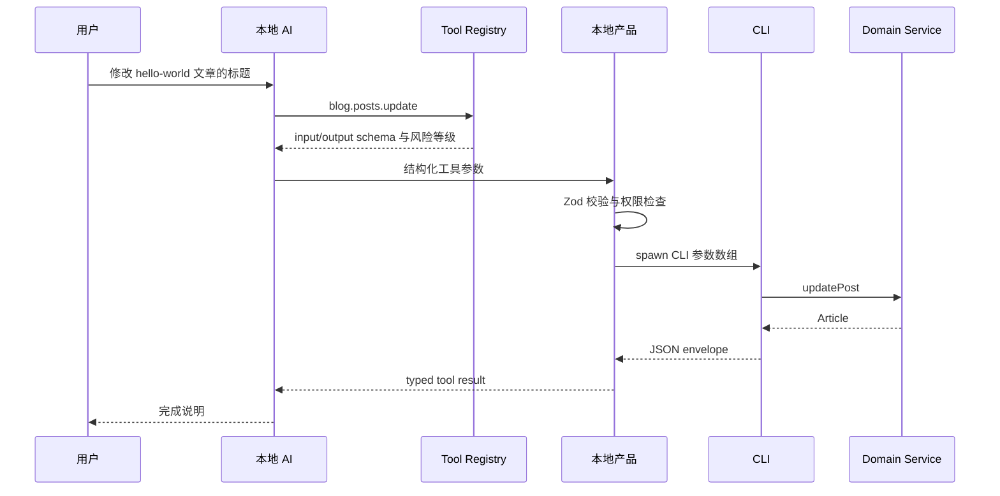

# TypeScript CLI 技术栈与架构设计指南

> 历史探索资料（2026-10-23），记录项目启动时的候选方案。当前结构与有效规格见[文档索引](../README.md)。

**版本：** 1.0  
**日期：** 2026-10-23  
**适用场景：** 项目内容管理、Skill 分发与更新、本地 AI 对话调用、后续模块扩展

## 文档目的

这份文档给出一套可以直接用于项目启动的 TypeScript CLI 技术方案。方案覆盖博客文章管理、Skill 管理和本地 AI 工具调用，并说明如何划分命令层、业务层、适配器、输出协议和安全边界。

核心结论是：**使用 TypeScript，但不要让 Commander 或任何 CLI 框架进入业务核心。CLI 只作为能力入口，真正复用的是一套类型化的 Tool Layer 和 Domain Service。**

---

## 目录

1. [技术选型结论](#技术选型结论)
2. [需求与工程约束](#需求与工程约束)
3. [推荐技术栈](#推荐技术栈)
4. [总体架构](#总体架构)
5. [项目目录组织](#项目目录组织)
6. [命令层设计](#命令层设计)
7. [博客管理模块](#博客管理模块)
8. [Skill 管理模块](#skill-管理模块)
9. [本地 AI 对话调用](#本地-ai-对话调用)
10. [输出协议与退出码](#输出协议与退出码)
11. [配置认证与安全](#配置认证与安全)
12. [测试发布与可观测性](#测试发布与可观测性)
13. [扩展性设计](#扩展性设计)
14. [实施路线](#实施路线)
15. [值得参考的 TypeScript CLI 仓库](#值得参考的-typescript-cli-仓库)
16. [关键决策清单](#关键决策清单)

---

## 技术选型结论

### 最终选择

```text
TypeScript
+ Node.js LTS
+ pnpm
+ Commander
+ Zod
+ @clack/prompts
+ Markdown + YAML
+ SQLite（按需）
+ Vitest
```

第一版采用单包分层结构。只有当本地产品开始直接复用核心能力，或者 Skill Installer 需要独立发布时，再拆成 pnpm Monorepo。

### 三层入口，一套业务能力

```text
人类 CLI ───────┐
                │
本地 AI Tool ───┼── Tool Registry ── Domain Service ── Adapters
                │
未来 MCP ───────┘
```

三种入口共享：

- 相同的输入 Schema。
- 相同的业务服务。
- 相同的错误类型。
- 相同的 JSON 输出。
- 相同的权限规则。

### 为什么选择 TypeScript

1. 博客工具需要 Markdown、YAML、文件监听、Git 和搜索能力，Node 生态成熟。
2. Skill 管理需要 HTTP、压缩包、SemVer、checksum 和文件系统操作。
3. 本地 AI 产品通常与 JavaScript/TypeScript、模型 SDK 和前端共享类型。
4. Zod Schema 可以同时用于 CLI 参数校验、Agent Tool 输入和文档生成。
5. 后续接入 MCP、ACP、TUI 或 Web 控制台时，不需要更换核心语言。

### 为什么不是其他方案

| 方案 | 不选作默认方案的原因 |
| --- | --- |
| Go + Cobra | 仍然适合 AI 调用型 CLI，但如果本地产品、AI SDK 和 Skill 生态都在 TypeScript，跨语言成本更高 |
| Rust + clap | 启动和原生交付更强，但博客与 Skill 管理不构成必须使用 Rust 的性能瓶颈 |
| Python + Typer/Click | 适合脚本和数据处理，但跨平台桌面交付、Node 产品复用和 Agent SDK 集成不占优势 |
| 自研完整参数解析器 | 命令和 flag 增长后，帮助、补全、错误处理和测试成本过高 |
| Effect CLI 起步 | 能力很强，但调试和团队上手成本高于当前需求 |

---

## 需求与工程约束

### 需求一：通过 CLI 管理博客文章

典型操作包括：

- 列出文章。
- 查看文章。
- 新建文章。
- 更新标题、正文、标签和发布状态。
- 删除文章。
- 发布文章。
- 全文搜索。
- 查看 Git diff 或生成 commit。

工程重点不是命令数量，而是文件安全、Schema 校验、原子写入和可恢复性。

### 需求二：管理 Skill 的分发与更新

典型操作包括：

- 从 Registry 或 GitHub 安装 Skill。
- 按 SemVer 选择版本。
- 检查 checksum。
- 更新到新版本。
- 校验本地文件。
- 移除 Skill。
- 发布新的 Skill 包。

工程重点是供应链安全、版本锁定、原子替换和失败回滚。

### 需求三：本地产品通过 AI 对话调用 CLI

典型路径：

```text
用户提出需求
    ↓
AI 选择允许的工具
    ↓
Tool Registry 校验参数
    ↓
本地产品启动 CLI 子进程
    ↓
CLI 调用 Domain Service
    ↓
返回结构化 JSON
    ↓
AI 组织结果并回复用户
```

工程重点是：

- 模型不能直接拼接 shell。
- 所有参数必须有 Schema。
- 读、写、破坏性操作需要分级。
- 控制超时、取消和重复调用。
- CLI 输出必须可稳定解析。

### 未来扩展需求

可能增加：

- MCP Tool Server。
- Agent Skill 安装。
- 远程 Skill Registry。
- 其他内容类型。
- 本地 Web 控制台。
- 更多 AI 模型和 Provider。
- 第三方插件。

因此第一版必须把命令、业务、适配器和协议分开，避免未来为了增加入口而复制业务代码。

---

## 推荐技术栈

| 层次 | 推荐选择 | 用途 |
| --- | --- | --- |
| 语言 | TypeScript | 跨模块类型契约与可维护性 |
| 运行时 | Node.js LTS | 文件、进程、网络、CLI |
| 包管理 | pnpm | 快速安装与 Workspace |
| 命令框架 | Commander | 子命令、参数、帮助、版本 |
| Schema | Zod | 输入、配置、JSON Schema、Tool 定义 |
| 交互 | @clack/prompts | 登录、安装、确认、选择 |
| HTTP | 原生 `fetch` 或 undici | Registry、API、下载 |
| 文件监听 | chokidar | 文章与 Skill 目录监听 |
| Markdown | unified/remark 或轻量解析器 | 文章解析与格式化 |
| Frontmatter | gray-matter 或 YAML + Zod | 文章元数据 |
| 数据库 | SQLite | 搜索索引、任务和缓存 |
| 构建 | tsdown 或 esbuild | Node ESM 打包 |
| 测试 | Vitest | 单元、契约、集成 |
| 单文件分发 | Node SEA 或 Bun compile | 后续阶段 |
| Agent 接入 | JSON Tool API，再增加 MCP | 本地 AI 和外部 Agent |

### 版本策略

- Node.js 使用当前 LTS。
- TypeScript 和 CLI 框架锁定主版本及 lockfile。
- 不在第一版追随所有最新主版本。
- 发布前执行依赖审计和跨平台 smoke test。

---

## 总体架构



### 架构原则

1. **CLI 是适配器。** Commander 只处理用户在终端输入的参数。
2. **Domain Service 是唯一业务实现。** 博客和 Skill 逻辑不能依赖终端或 AI 框架。
3. **Adapter 承担 I/O。** 文件、Git、HTTP、SQLite、Keyring 和归档库都通过接口访问。
4. **Output Service 统一输出。** 业务层返回数据，不返回带颜色的字符串。
5. **Tool Registry 是共享契约。** CLI、本地 AI 和未来 MCP 从同一份工具定义派生。
6. **重型依赖按需加载。** `--help`、`--version` 和简单列表命令不加载搜索、压缩包或 MCP SDK。

### AppContext

```ts
interface AppContext {
  cwd: string;
  config: AppConfig;
  logger: Logger;
  output: CliOutput;
  prompts: PromptService;
  fs: FileSystemPort;
  git: GitPort;
  http: HttpClientPort;
  blog: BlogService;
  skills: SkillService;
}
```

启动入口负责创建 Context，测试时注入临时目录和 mock 服务。命令 handler 不直接读取全局环境变量，也不直接调用 `process.exit`。

---

## 项目目录组织

### 第一阶段：单包分层

```text
src/
  bin/
    cli.ts

  cli/
    program.ts
    commands/
      blog/
        list.ts
        show.ts
        create.ts
        update.ts
        delete.ts
        publish.ts
        search.ts
      skill/
        install.ts
        list.ts
        update.ts
        remove.ts
        verify.ts
        publish.ts

  core/
    blog/
      service.ts
      ports.ts
      types.ts
    skills/
      service.ts
      ports.ts
      manifest.ts
      lockfile.ts
      types.ts

  adapters/
    filesystem/
    git/
    http/
    archive/
    sqlite/
    keyring/
    prompts/

  output/
    service.ts
    text.ts
    json.ts
    ndjson.ts
    errors.ts

  tools/
    definitions.ts
    registry.ts

  config/
    schema.ts
    load.ts

  app/
    context.ts
```

### 后续阶段：Monorepo

```text
apps/
  cli/
  local-product/

packages/
  core/
  tools/
  output/
  skill-installer/
  mcp/
  test-support/
```

拆包条件：

- 本地产品需要直接 import 核心服务。
- Skill Installer 需要单独发布。
- MCP Server 有独立运行和发布周期。
- 多个 CLI 共享同一套输出和配置能力。

---

## 命令层设计

### 单一命令定义

建议用一个定义对象同时描述 CLI、Agent Tool、帮助和测试：

```ts
export const updatePostCommand = createCommand({
  name: "blog.posts.update",
  summary: "更新博客文章",
  input: updatePostSchema,
  output: articleSchema,
  risk: "write",
  examples: [
    "blog posts update hello-world --title '新标题'",
  ],
  async execute(input, ctx) {
    return ctx.blog.updatePost(input);
  },
});
```

### 命令层只做四件事

1. 将 argv、flags 和 stdin 转换为 typed input。
2. 校验参数组合与权限。
3. 调用 Domain Service。
4. 把结果交给 Output Service。

### 不应出现在命令层的逻辑

- 直接读写文章文件。
- 直接解压 Skill 包。
- 直接发送 HTTP 请求。
- 直接打印人类文本。
- 直接调用 `process.exit`。
- 直接判断 AI Provider。

### 推荐命令命名

```bash
blog posts list
blog posts show <slug>
blog posts create
blog posts update <slug>
blog posts delete <slug>
blog posts publish <slug>
blog posts search <query>

skill list
skill install <name>@<version>
skill update [name]
skill remove <name>
skill verify [name]
skill publish <path>
```

稳定命令用于文档、Skill 和 Tool Schema。短别名可以提供，但不应成为自动化依赖。

---

## 博客管理模块

### 数据结构

```ts
type ArticleMeta = {
  slug: string;
  title: string;
  description?: string;
  publishedAt?: string;
  updatedAt: string;
  tags: string[];
  draft: boolean;
};

type Article = {
  meta: ArticleMeta;
  content: string;
  path: string;
};
```

### 推荐文件格式

```md
---
title: Hello World
slug: hello-world
description: Example article
publishedAt: 2026-10-23T10:00:00Z
updatedAt: 2026-10-23T10:00:00Z
tags:
  - typescript
  - cli
draft: false
---

Article content here.
```

### 核心接口

```ts
interface ArticleRepository {
  list(): Promise<ArticleMeta[]>;
  get(slug: string): Promise<Article | null>;
  create(article: Article): Promise<void>;
  update(slug: string, patch: ArticlePatch): Promise<Article>;
  delete(slug: string): Promise<void>;
}

interface MarkdownParser {
  parse(raw: string): ParsedMarkdown;
  stringify(article: Article): string;
}

interface ArticleIndex {
  rebuild(): Promise<void>;
  search(query: string): Promise<SearchHit[]>;
}
```

### 原子写入

写文章时按以下顺序执行：

1. 读取并校验现有文件。
2. 根据 Zod Schema 生成新内容。
3. 写入同目录临时文件。
4. flush 临时文件。
5. 使用原子 rename 替换目标文件。
6. 更新搜索索引。
7. 可选执行 Git 操作。

任何步骤失败都返回 typed error，不留下半写入文章。

### Blog 注意事项

- slug 必须唯一，并限制路径分隔符和危险字符。
- 日期统一保存为 ISO 8601，同时明确展示时区。
- frontmatter 损坏时禁止静默覆盖。
- 删除默认需要确认，Agent 调用必须使用显式授权。
- `--dry-run` 输出计划和目标路径。
- 写文件后保留更新时间，但 reparsing 不能无限刷新时间。
- 搜索索引是可重建缓存，不是文章数据源。
- Git commit 只提交本次操作涉及的路径。
- Windows 下注意文件占用、路径分隔符和换行符。

---

## Skill 管理模块

### 推荐 Skill 包

```text
example-skill/
  SKILL.md
  manifest.json
  references/
  scripts/
  checksums.txt
```

### manifest 示例

```json
{
  "name": "example-skill",
  "version": "1.4.2",
  "description": "Example skill",
  "engines": {
    "mytool": ">=1.0.0 <2.0.0"
  },
  "permissions": {
    "filesystem": "workspace",
    "network": ["registry.example.com"],
    "process": false
  }
}
```

### 安装流程


### 锁文件示例

```json
{
  "version": 1,
  "skills": {
    "example-skill": {
      "version": "1.4.2",
      "source": "registry",
      "checksum": "sha256:...",
      "targets": [
        ".agents/skills/example-skill"
      ],
      "installedAt": "2026-10-23T10:00:00Z"
    }
  }
}
```

### 核心接口

```ts
interface SkillResolver {
  resolve(name: string, range?: string): Promise<SkillManifest>;
}

interface SkillDownloader {
  download(manifest: SkillManifest): Promise<string>;
}

interface SkillVerifier {
  verify(packagePath: string, manifest: SkillManifest): Promise<void>;
}

interface AgentTargetAdapter {
  detect(): Promise<AgentTarget[]>;
  install(packagePath: string, target: AgentTarget): Promise<void>;
  remove(target: AgentTarget): Promise<void>;
}
```

### Skill 注意事项

- 版本必须使用 SemVer。
- 安装前展示来源、版本、权限和信任等级。
- checksum 不匹配时立即停止。
- 拒绝 `..`、绝对路径、设备文件和危险符号链接。
- 限制解压后的总大小、文件数量和目录深度。
- 先写暂存目录，再原子替换目标目录。
- 锁文件写入成功后才能删除旧版本。
- 更新失败自动恢复旧版本。
- 删除只处理锁文件登记的文件。
- Skill 的脚本默认不可执行，执行权限需要单独声明和确认。
- 如果支持远程 Registry，考虑签名或 provenance。

---

## 本地 AI 对话调用

### ToolDefinition

```ts
type RiskLevel = "read" | "write" | "destructive";

type ToolDefinition<I, O> = {
  name: string;
  description: string;
  input: z.ZodType<I>;
  output: z.ZodType<O>;
  risk: RiskLevel;
  execute(input: I, ctx: AppContext): Promise<O>;
};
```

### 调用流程



### 禁止的做法

```ts
// 不要这样做
exec(`blog posts update ${slug} --title "${title}"`);
```

模型或用户输入可能包含 shell 元字符，导致命令注入。

推荐：

```ts
spawn("blog", [
  "posts",
  "update",
  slug,
  "--title",
  title,
  "--json",
]);
```

### 权限分级

| 等级 | 典型操作 | AI 行为 |
| --- | --- | --- |
| `read` | list、show、search | 可以直接调用 |
| `write` | create、update、install | 通过 Schema 后可自动执行 |
| `destructive` | delete、remove、reset | 必须显式确认或授予权限 |

### 多步任务

AI 发起多步任务时：

- 限制最大工具调用次数。
- 每一步返回结构化结果。
- 支持取消信号。
- 每个写操作有明确目标路径。
- 多步执行记录 session ID。
- 任何失败都报告已完成步骤和未执行步骤。

### Skill 与 MCP

推荐顺序：

1. CLI 命令。
2. 结构化 JSON 输出。
3. Agent Skill 文档。
4. 可选 MCP Adapter。

Skill 负责告诉 Agent 如何调用 CLI。MCP 负责给无法执行 shell 的客户端提供标准工具接口。两者都不是业务核心。

---

## 输出协议与退出码

### 成功响应

```json
{
  "ok": true,
  "data": {},
  "meta": {
    "durationMs": 28
  }
}
```

### 错误响应

错误写入 stderr：

```json
{
  "ok": false,
  "error": {
    "code": "ARTICLE_NOT_FOUND",
    "message": "Article not found",
    "detail": "No article matches slug hello-world",
    "retryable": false,
    "suggestion": "Run blog posts list"
  }
}
```

### 输出规则

- stdout 只写结果。
- stderr 写日志、提示和错误。
- 非 TTY 环境自动关闭颜色和 spinner。
- 提供 `--json`、`--pretty`、`--no-color`。
- 批量或流式结果使用 NDJSON。
- 日志中不输出凭证和文章正文。

### 建议退出码

| 退出码 | 含义 |
| --- | --- |
| `0` | 成功 |
| `2` | CLI 用法或参数错误 |
| `3` | 业务校验失败 |
| `4` | 权限或认证失败 |
| `5` | 外部服务失败 |
| `130` | 用户取消 |

退出码一旦公开，应作为兼容性契约维护。

---

## 配置认证与安全

### 配置优先级

```text
CLI flags
  > 环境变量
  > 项目配置
  > 用户配置
  > 默认值
```

配置文件需要：

- Zod Schema。
- 版本字段。
- 迁移函数。
- 清晰的路径来源。
- `config show --json`。

### 凭证

- CI 和 Agent 使用环境变量或 token。
- 人类交互式登录使用浏览器回调或 device flow。
- 长期凭证写入系统 Keyring。
- 降级到文件时必须限制权限。
- 错误、日志和 trace 统一脱敏。

### 必须防范的风险

| 风险 | 控制措施 |
| --- | --- |
| shell 注入 | 结构化参数 + `spawn(command, args[])` |
| 路径穿越 | 路径解析到工作区根目录，拒绝越界 |
| 误删 | dry-run、确认、备份、权限等级 |
| Skill 供应链 | 来源白名单、checksum、签名或 provenance |
| 恶意归档 | 限制大小、数量、深度、绝对路径和链接 |
| 提示注入 | 网页和文件内容只作为数据，不改变权限 |
| 凭证泄露 | Keyring、环境变量、日志脱敏 |
| 并发写入 | 文件锁、临时文件、原子 rename |
| Agent 无限循环 | 最大调用数、超时、取消、重试上限 |
| 跨平台差异 | Windows、macOS、Linux 的 E2E 测试 |

---

## 测试发布与可观测性

### 测试分层

| 层级 | 重点 |
| --- | --- |
| 单元测试 | Service、Resolver、Schema、错误映射 |
| 契约测试 | 命令参数、JSON envelope、退出码、帮助文本 |
| 适配器测试 | 临时文件系统、HTTP mock、归档安全 |
| E2E 测试 | 真实 CLI 子进程、TTY/非 TTY、临时 workspace |
| 发布测试 | 包内容、安装、升级、跨平台二进制启动 |

### 建议测试场景

- frontmatter 损坏。
- slug 冲突。
- 文件写入中途失败。
- Skill checksum 错误。
- 归档中包含 `../`。
- 网络中断和重试。
- 并发安装同一个 Skill。
- 非 TTY 环境误触 prompt。
- JSON 输出包含日志污染。
- Ctrl+C 后的资源清理。

### 发布顺序

1. 本地 tarball 和 npm 包。
2. GitHub Release 与 checksums。
3. GitHub Actions 多平台 smoke test。
4. Homebrew 或安装脚本。
5. Node SEA 或 Bun 单文件二进制。

Node SEA 和 Bun compile 并非第一版必需。引入前需要验证原生模块、动态 import、资源文件、代码签名和自动更新。

### 可观测性

- 日志写 stderr，默认使用结构化 JSON。
- 记录命令、耗时、退出码和错误代码。
- 默认不上传远程遥测。
- 如需遥测，应提供显式说明和关闭开关。
- 永远不上传凭证、文章正文和完整用户路径。

---

## 扩展性设计

### CommandRegistry

新增领域模块时注册命令，不在一个巨型文件中修改多个条件分支。

### ToolRegistry

新增可被 AI 调用的能力时，同时声明：

- name。
- description。
- input/output Schema。
- risk。
- execute。

CLI、本地 AI、未来 MCP 从同一注册表读取。

### InstallerMap

Skill 来源和安装目标用 InstallerMap 组合：

```ts
type SkillInstaller = {
  name: string;
  detect(): Promise<boolean>;
  install(ctx: SkillInstallContext): Promise<void>;
  update?(ctx: SkillInstallContext): Promise<void>;
  remove?(ctx: SkillInstallContext): Promise<void>;
};
```

### AdapterRegistry

以下都可以作为 Adapter 扩展：

- Markdown Parser。
- Search Index。
- Git Adapter。
- Skill Source。
- Archive Format。
- Agent Target。
- Authentication Provider。

### 暂不引入的能力

- 完整插件市场。
- 动态加载第三方 node_modules。
- 自研 TUI。
- 完整 MCP Server。
- 多语言进程架构。

等核心命令和 Tool 协议稳定后再增加。

---

## 实施路线

### 阶段 1：工程骨架

交付：

- Commander 命令树。
- AppContext。
- CliOutput。
- AppError 与退出码。
- `--version`、`--help`、`--json`。
- 基础单元测试。

完成标准：CLI 可以安装并运行，错误和输出契约稳定。

### 阶段 2：博客管理

交付：

- list、show、create、update、delete。
- Markdown + frontmatter。
- 原子写入。
- slug 校验。
- 基础搜索。
- Git diff 或可选 commit。

完成标准：本地文章增删改查不损坏文件，失败可恢复。

### 阶段 3：Skill 管理

交付：

- manifest。
- Registry/Source。
- 下载与 checksum。
- Staging 安装。
- lockfile。
- update、remove、verify。

完成标准：重复安装和更新结果一致，失败自动回滚。

### 阶段 4：本地 AI 接入

交付：

- Tool Registry。
- JSON envelope。
- spawn CLI adapter。
- read/write/destructive 权限。
- 超时与取消。

完成标准：AI 可以安全完成博客增删改查，不直接执行 shell 字符串。

### 阶段 5：分发与质量

交付：

- npm 包。
- GitHub Actions。
- 多平台 smoke test。
- 发布说明。
- 依赖与安全检查。

完成标准：新机器可安装、升级和卸载。

### 阶段 6：扩展

可选：

- Agent Skill。
- MCP Adapter。
- 远程 Skill Registry。
- 更多内容适配器。
- 单文件二进制。

---

## 值得参考的 TypeScript CLI 仓库

### 最值得借鉴的架构

| 仓库 | 借鉴重点 |
| --- | --- |
| [AsyncAPI CLI](https://github.com/asyncapi/cli) | CLI 与 HTTP API 共用 Domain Services；统一 ServiceResult |
| [Astro](https://github.com/withastro/astro) | 命令层的 `core`/`infra` 分层与动态加载 |
| [Cloudflare Wrangler](https://github.com/cloudflare/workers-sdk) | `createCommand` 与 `HandlerContext` 依赖注入 |
| [create-t3-app](https://github.com/t3-oss/create-t3-app) | `InstallerMap` 组合安装器，适合 Skill 安装 |
| [Vercel CLI](https://github.com/vercel/vercel) | 命令元数据、帮助系统与输出管理器 |
| [Shopify CLI](https://github.com/Shopify/cli) | BaseCommand、JSON Schema、非 TTY 规则 |
| [Supabase CLI](https://github.com/supabase/cli) | Output Service 和接口抽象 |
| [Firecrawl CLI](https://github.com/firecrawl/cli) | CLI、Skills、MCP 三入口 |
| [Kimi Code](https://github.com/MoonshotAI/kimi-code) | Agent Core、TUI、ACP 和 CLI 分层 |
| [Gemini CLI](https://github.com/google-gemini/gemini-cli) | CLI/Core/SDK/Server 分包和流式输出 |
| [MiniMax CLI](https://github.com/MiniMax-AI/cli) | 小型 CLI 的轻量命令注册表 |
| [Vite](https://github.com/vitejs/vite) | CLI 作为项目配置适配层 |

### 建议重点阅读的源码

1. AsyncAPI 的 `docs/architecture.md`。
2. Wrangler 的 `core/types.ts` 和 `create-command.ts`。
3. Astro 的 `packages/astro/src/cli/index.ts`。
4. create-t3-app 的 `cli/src/installers/index.ts`。
5. Vercel 的 `packages/cli/src/commands/build/command.ts` 和对应 handler。
6. Shopify 的 `BaseCommand`。
7. Supabase 的 `output.service.ts`。
8. Firecrawl 的 `commands/setup.ts`。

---

## 关键决策清单

| 编号 | 决策 | 落地方式 |
| --- | --- | --- |
| D1 | TypeScript + Node.js LTS | 统一内容、Skill、AI SDK 和本地产品 |
| D2 | Commander + Zod | 成熟命令树与统一输入 Schema |
| D3 | 单包优先 | 降低首版工程成本，保留后续拆包路径 |
| D4 | Domain Service + Ports/Adapters | 业务逻辑可测试、可复用 |
| D5 | Tool Registry 单一事实来源 | CLI、AI 和未来 MCP 共享契约 |
| D6 | JSON 输出先于 MCP | 先稳定协议，再接更多入口 |
| D7 | Skill 使用 Manifest 与 lockfile | 保证版本、完整性和回滚 |
| D8 | AI 使用 spawn 参数数组 | 阻止命令注入 |
| D9 | 重型依赖按需加载 | 保持 CLI 启动速度 |
| D10 | 先 npm，后单文件二进制 | 降低首版发布复杂度 |

---

## 首版验收条件

- [ ] 博客文章可以通过 CLI 完成 list、show、create、update 和 delete。
- [ ] 写入使用临时文件和原子 rename。
- [ ] 所有输入通过 Zod 校验。
- [ ] Skill 安装会写入 lockfile，并能校验 checksum。
- [ ] Skill 更新失败会恢复旧版本。
- [ ] 本地 AI 只产生结构化参数，不生成 shell 字符串。
- [ ] stdout 只有结果，stderr 只有诊断。
- [ ] JSON envelope 和退出码有契约测试。
- [ ] 危险操作支持 dry-run 或确认。
- [ ] macOS、Linux 和 Windows 至少完成一次安装与基础命令 smoke test。

---

## 最终建议

从博客模块开始实施，但先完成通用工程骨架。优先实现：

```text
AppContext
+ createCommand
+ CliOutput
+ AppError
+ ArticleRepository
```

这三条博客命令最适合验证架构：

```bash
blog posts list --json
blog posts show <slug> --json
blog posts update <slug> --title "新标题"
```

它们覆盖配置、文件读取、Schema、业务服务、输出和错误映射。架构稳定后，再按同样模式实现 Skill 管理和 AI Tool Registry。
